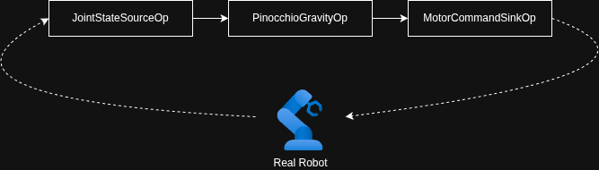
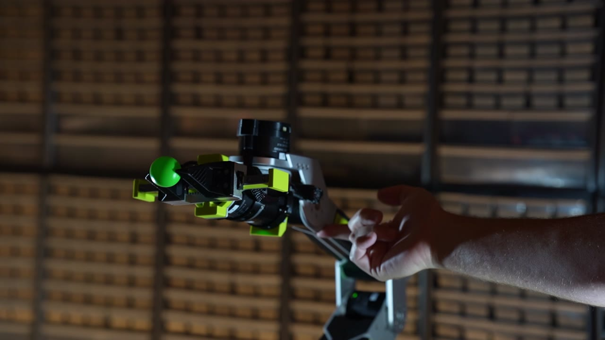
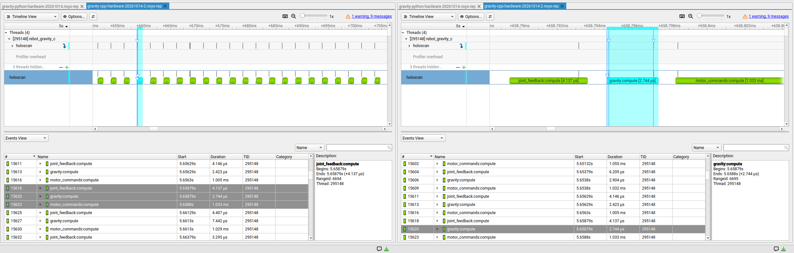
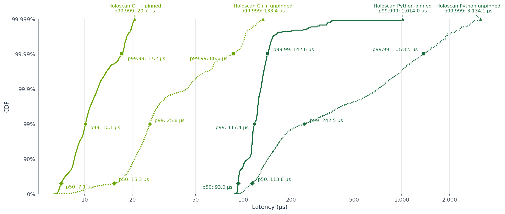

# Make a Robot Arm Feel Weightless with NVIDIA Holoscan 5

*Build a responsive gravity-compensation loop with Pinocchio, a Seeed Studio reBot arm, and a simple Holoscan graph in Python or C++.*

Imagine effortlessly guiding a robot arm by hand while its motors carefully supply just the right amount of torque needed to support its weight and keep the robot upright. This simple interaction is a useful starting point for robots that learn by demonstration, manipulate objects, or work alongside people.

Building a gravity-compensation loop is only possible by continuously calculating the inverse dynamics of the system based on precise models of all the links of the robot arm, their dimensions, masses, and moments of inertia. And importantly, this calculation requires knowing the current state of the robot. This calculation needs to be done rapidly, with low jitter, and low latency, so gravity-comp demos are an excellent proof of life for both the robot model and the runtime that's executing these algorithms.

The NVIDIA Holoscan 5 platform introduces the 5.0 release of Holoscan SDK (HSDK), a ground-up rewrite built for low-latency GPU-based and CPU-based perception and control workloads. This tutorial uses HSDK 5.0 to build and profile a robot control loop. While working through this demo, we'll build custom HSDK operators and wire them into a graph. We'll test the code on a real robot and use the SDK's built-in Nsight Systems annotations to inspect latency and jitter.

This tutorial has been tested with HSDK 5.0 on x86 Ubuntu 24.04 and on Jetson Orin Nano and Jetson Thor running JetPack 7.2.

## Why HSDK 5.0?

A responsive robot needs more than a correct control algorithm; it needs a low-latency, low-jitter runtime that provides observability for exactly how a developer's code is running.

**HSDK 5.0 brings low-latency control and high-throughput perception into one programming model**, with execution paths designed for CPU- and GPU-based workloads. Its goal is a transparent runtime: minimize avoidable framework overhead while making application execution explicit and inspectable.

**Keep the control path focused on the work.** HSDK uses partitions to group chains of operators on a single thread, avoiding cross-thread handoffs and unnecessary syscalls, reducing latency and jitter. Clock and data-arrival triggers express when work should run, while bounded, drop-oldest queues prevent outdated work from accumulating.

**Bring existing algorithms and code rather than rewriting them for a framework.** HSDK 5.0 has a new, lightweight programming model that can be easily integrated into existing code bases, and it's never been easier to get data into and out of HSDK graphs.

**Add perception without adopting a different programming model.** Whether you're handling 10 kHz CPU-centric motor control loops, heavy-throughput GPU algorithms, or AI inference, HSDK lets developers and their agents clearly express execution intent using the same operators, ports, and graph APIs, logically splitting their workloads into separate graphs that can coexist, with the ability to pin partitions to dedicated CPU cores, CUDA green contexts, or even execute as a CUDA graph.

**Inspect the plan, then measure the result.** Operators express their intent with timing contracts, and before the first run, the compiled plan exposes how the application will execute and catches configuration errors before deployment. This means agents and developers can quickly iterate on a design without ever deploying to real hardware. Plus, built-in NVTX annotations make operator execution and message transfers visible in Nsight Systems. Developers can examine host control-path latency and update jitter, then repeat those measurements as the application grows.

## An accessible platform for torque-control development

We're building this tutorial around the [Seeed Studio reBot Arm B601-DM](https://www.seeedstudio.com/reBot-Arm-B601-DM-p-6740.html), which is an accessible, affordable platform for getting started with modern robotics control. Most low-cost robot arm development platforms use highly-geared hobby servos, which are only suitable for positional control. The reBot Arm uses quasi-direct-drive (QDD) actuators that provide high torque bandwidth for both control and sensing — important for haptic, co-bot, or other torque-oriented projects like this one.

## Starting off with gravity-comp

Before adding perception pipelines, motion planners, and other higher-level controls, building a basic gravity compensation loop helps provide a useful (and entertaining!) sanity-check for whether your simulation model accurately describes the physical robot. While position-control examples can mask problems with joint axes, offsets, link placements, masses, and moments, all of these affect the required torque in instantly-observable ways; any bugs in DH parameters or mass properties can make the arm sag or push upward as its pose changes.

Even if your end application doesn't need gravity-comp, torque control lets us shape how the robot responds to forces—a key ingredient in safer interaction between humans and co-bots. Our arm combines gravity feedforward with light stiffness and damping, so it supports its weight while yielding to a person's hand.

That flexibility makes timing critical. Tracking a position through torque commands requires rapid, consistent feedback at hundreds or thousands of Hz, and runtime overhead and thread handoffs can add phase lag and jitter that cause the robot to become unstable.

This tutorial uses [Pinocchio](https://stack-of-tasks.github.io/pinocchio/) as the inverse-dynamics solver. It loads the robot's URDF model and provides a Recursive Newton–Euler Algorithm (RNEA) solver, which calculates joint torques for specified positions, velocities, and accelerations. We also use the [motorbridge](https://motorbridge.seeedstudio.com/) library to read joint feedback and send commands to the arm's motors.

## Set up the Python example

This walkthrough uses HSDK's Python API. The tutorial repository also contains a complete C++ implementation, with its own [build instructions](docs/technical-guide.md#c-build). Both implement the same three-operator control loop.

You need a reBot Arm B601-DM with Damiao motors, its power supply and serial connection, Python 3.12 or newer on Linux, and Git. Your account needs read/write access to the configured serial device, typically through the `dialout` group on Ubuntu. The setup commands require network access to fetch packages and the robot model.

The Seeed URDF is fetched during setup because its license provenance is unconfirmed; it is not distributed in this repository. The [fetch script](scripts/fetch-urdf.py) clones a pinned upstream revision, checks the source SHA-256, and extracts the dynamics model. See [model provenance](urdf/SOURCES.md) for details.

From the `tutorials/rebot-gravity-compensation` directory on the Linux host connected to the arm:

```bash
python3.12 scripts/fetch-urdf.py
python3.12 -m venv build/python-venv
build/python-venv/bin/python -m pip install --only-binary=:all: -r requirements-python.txt
build/python-venv/bin/python -m pip check
```

Check the serial device and motor IDs in the arm's [configuration file](config/rebotarm_dm.yaml). The [technical guide](docs/technical-guide.md) covers configuration, the math, and hardware startup.

## Express the control loop as three operators

HSDK 5.0 has two core programming concepts: operators and graphs. To read the robot's state, calculate the command using the inverse-dynamics solver, and send it to the arm, we can decompose that problem into three operators wired into a graph:



Operators are subclassed from `Operator` and have three important methods to implement:


| Method       | Purpose                                          |
| ------------ | ------------------------------------------------ |
| `setup()`    | Declare input and output ports.                  |
| `contract()` | Declare when to run and which input data to use. |
| `compute()`  | Read input(s), do work, and publish output(s).   |


Here are outlines of the three operators to build:

### 1. Read joint state on a clock

`JointStateSourceOp` declares one output in `setup()`. Its `OnClock` contract requests a tick every 2.5 ms (we're running this demo at 400 Hz). Each `compute()` reads all seven motors and emits their state:

```python
import holoscan as hsdk

class JointStateSourceOp(hsdk.Operator):
    state = hsdk.Output("state", hsdk.pyobject)

    def setup(self, spec):
        spec.output(self.state)

    def contract(self):
        return hsdk.Contract().trigger(hsdk.OnClock(period=hsdk.time.us(2500)))

    def start(self):
        self.sequence = 0

    def compute(self, ctx):
        self.sequence += 1
        self.state.emit(robot.read_state(self.sequence))
```


### 2. Compute gravity compensation when state arrives

`PinocchioGravityOp` declares a state input and command output. `OnEach` runs it when state arrives. The `hsdk.Param` declarations expose gains, torque scaling, and joint direction as operator parameters:

```python
class PinocchioGravityOp(hsdk.Operator):
    state = hsdk.Input("state", hsdk.pyobject)
    command = hsdk.Output("command", hsdk.pyobject)
    kp = hsdk.Param(1.5, range=(0.0, 500.0))
    kd = hsdk.Param(1.0, range=(0.0, 5.0))
    tau_scale = hsdk.Param([1.0] * 6)
    joint_direction = hsdk.Param([1.0] * 6)

    def setup(self, spec):
        spec.input(self.state, queue_depth=1)
        spec.output(self.command)

    def contract(self):
        return hsdk.Contract().trigger(hsdk.OnEach(self.state))

    def compute(self, ctx):
        state = self.state.receive_data()
        command = controller.compute(
            state, kp=self.kp, kd=self.kd,
            tau_scale=self.tau_scale, joint_direction=self.joint_direction)
        self.command.emit(command)
```

`compute()` passes the observed state and current parameters to a helper that maps the six arm angles into the URDF model, checks limits, and obtains gravity torques through Pinocchio:

```python
gravity = pin.computeGeneralizedGravity(self.model, self.data, self.q)[self.v_indices]
```

Its torques become feedforward in the motors' commands, alongside position, velocity, stiffness, and damping. The arm uses gravity feedforward and the configured compliant gains from the first command.

### 3. Send each command to the motors

`MotorCommandSinkOp` declares one input and runs whenever a command arrives. `compute()` hands the command to a small robot helper, which rejects expired, out-of-order, or out-of-range commands before sending the batch:

```python
class MotorCommandSinkOp(hsdk.Operator):
    command = hsdk.Input("command", hsdk.pyobject)

    def setup(self, spec):
        spec.input(self.command, queue_depth=1)

    def contract(self):
        return hsdk.Contract().trigger(hsdk.OnEach(self.command))

    def compute(self, ctx):
        robot.send_command(self.command.receive_data())

    def stop(self):
        robot.disable()
```

After sending all seven motor commands, the helper records the completion time. If no batch completes for 100 ms (the default timeout), the application's watchdog attempts to disable the motors and stops the graph. The operator's `stop()` callback also disables the motors.

## Wire, compile, prepare, and run

The application connects the operators through their ports and supplies the gravity parameters when creating the operator:

```python
graph = hsdk.Graph("rebot-gravity-python", default_clock=hsdk.RealtimeClock)
source = graph.op(JointStateSourceOp, "joint_feedback")
gravity = graph.op(PinocchioGravityOp, "gravity", **controller.parameters.operator_kwargs())
sink = graph.op(MotorCommandSinkOp, "motor_commands")
graph.add_flow(source.state, gravity.state, queue_depth=1, queue_policy=hsdk.QueuePolicy.DROP_OLDEST)
graph.add_flow(gravity.command, sink.command, queue_depth=1, queue_policy=hsdk.QueuePolicy.DROP_OLDEST)
graph.partition("control").add(source).add(gravity).add(sink)
```

A partition groups operators whose callbacks execute serially on one runtime-owned thread. Keeping all three in `control` avoids thread handoffs between reading state, calculating torque, and sending commands. The source sets the pace; the other operators follow the data. Depth-one, drop-oldest queues keep old samples from piling up.

HSDK compiles this description into an inspectable execution plan before we enable the motors:

```python
plan = hsdk.compile(build_graph(robot, controller))
if not plan:
    raise RuntimeError(plan.summary())

prepare_gravity_compensation(robot, controller)
hsdk.run_async(plan)
```

Model and motor initialization live in `prepare_gravity_compensation()`, after graph compilation and immediately before execution. The application's signal handlers set `stop_requested` on Ctrl+C; the main loop supervises command progress, and the session context manager stops and joins the graph. The control policies cover startup, watchdogs, and shutdown.

## See the arm respond

Start with the arm securely mounted in its power-off-safe home position. Keep clear of joint pinch points and keep the power disconnect accessible. Ctrl+C, a detected fault, or a watchdog timeout removes active weight support, so the arm can fall under gravity; return it home before normal shutdown.

```bash
build/python-venv/bin/python python/gravity_compensation.py
```

When `Gravity compensation active` appears, guide the arm by hand. Return it home manually before pressing Ctrl+C, which disables the motors.



*The controller updates joint torques as the person changes the arm's pose.*

## Measure latency and jitter with Nsight Systems

HSDK integrates with [NVIDIA Nsight Systems](https://docs.nvidia.com/nsight-systems/UserGuide/index.html) to analyze execution of both GPU- and CPU-based workloads. No tracing decorators or custom timing code are needed. Profile the unmodified application:

```bash
mkdir -p build/profiles
nsys profile -t nvtx --sample=none --backtrace=none --cpuctxsw=none \
  -o build/profiles/gravity-python \
  build/python-venv/bin/python python/gravity_compensation.py
```

Open the timeline:

The same annotations are available in C++; the trace below shows the C++ implementation of this control loop.



You can also calculate a standard range summary:

```bash
nsys stats --report nvtx_sum build/profiles/gravity-python.nsys-rep
```


## Pinning Cores

HSDK's deployment API lets us pin the `control` partition to a CPU. For these runs, we put helper and profiler threads on another CPU, then used a temporary Linux cgroup to reserve both physical cores, including their SMT siblings, from other applications. This is a simple setup that needs no kernel rebuild, boot-parameter changes, or reboot, but interrupts, timers, and some kernel threads can still run on those cores.

We compared all four configurations, retaining more than one million cycles per run. HSDK latency runs from entry into the first operator to entry into the last, excluding motor-command transmission. Solid curves show pinned runs; dotted curves show unpinned runs.




| Implementation           | p50 (µs) | p99.99 (µs) | p99.999 (µs) |
| ------------------------ | -------- | ----------- | ------------ |
| HSDK C++ pinned      | 7.1      | 17.2        | 20.7         |
| HSDK C++ unpinned    | 15.3     | 86.6        | 133.4        |
| HSDK Python pinned   | 93.0     | 142.6       | 1,014.0      |
| HSDK Python unpinned | 113.8    | 1,373.5     | 3,134.1      |


Pinning plus isolation reduced the observed p99.99 latency by roughly 5× for C++ and 9.6× for Python. These sequential, profiled runs exclude the first ten seconds and retain latency outliers.

Both HSDK versions call Pinocchio's C++-based solver, but Python adds interpreter execution, object allocation, and GIL coordination around both Pinocchio and the HSDK runtime. Those costs matter for CPU control loops with microsecond latency budgets. C++ gives us more control over allocations and system calls in the critical path (although this example still allocates memory and is not a zero-syscall pipeline).

For GPU-based perception workloads taking milliseconds or tens of milliseconds—orders of magnitude longer—optimizing small allocations and incidental system calls on the CPU is usually less consequential. Python remains a practical way to compose these pipelines (provided that the pipeline elements are implemented in CUDA).

## Next Steps

This tutorial illustrates how to use HSDK 5.0 to build low-latency control pipelines. Our three-operator example covers the basics; the [Cartesian point-hold example](docs/technical-guide.md#cartesian-point-hold) adds kinematics and impedance control as reusable HSDK operators. It captures a goal position while maintaining compliance and leaving orientation free.

Gravity compensation provides a foundation for hand-guided teaching, teleoperation, and manipulation. To extend the application with perception, explore the [Holoscan Modules tutorials](../holoscan-modules/README.md), which show how to use and package reusable operators.

For configuration, the control math, C++ build instructions, and tests, see the [technical guide](docs/technical-guide.md).