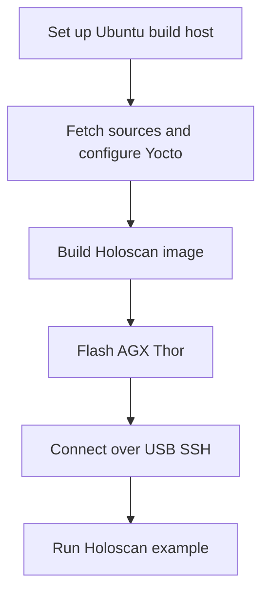

<!--
SPDX-FileCopyrightText: Copyright (c) 2026 NVIDIA CORPORATION & AFFILIATES. All rights reserved.
SPDX-License-Identifier: Apache-2.0
-->

# Build and run the Holoscan Yocto demo on AGX Thor



This tutorial takes you from a fresh Ubuntu host to a Jetson AGX Thor T5000 devkit
running a Holoscan application on a custom Yocto Linux image. Along the way you
will:

1. Prepare an Ubuntu 24.04 host to build Yocto images and flash Jetson boards.
2. Fetch NVIDIA's `tegra-demo-distro` and configure a build for AGX Thor.
3. Build the `demo-image-holoscan` image.
4. Flash the image to the devkit over USB.
5. Connect to the board over USB networking.
6. Run the installed Holoscan hello-world example in C++ and check the Python
   bindings.
7. Optionally, run the Holoscan SDK test suite on the board.

No camera or external dataset is needed.

The demo image contains more than this tutorial uses. Alongside the Holoscan SDK
runtime and Python bindings, it includes Holoscan Camera, the SDK and Camera
example applications, SDK benchmarks, a graphical desktop, NetworkManager,
Docker, and the NVIDIA Container Toolkit. The image recipe can also generate a
cross-development SDK for building your own Holoscan applications on the host.
This tutorial covers only getting the image running and confirming that
Holoscan works; it does not cover camera setup, the other examples, benchmarks,
containers, or cross-compiling.

## 1. Prepare the host

You need:

- A native x86-64 Ubuntu 24.04 host for building and flashing.
- At least 400 GB of free disk space and 32 GB of RAM (64 GB recommended).
- An NVIDIA Jetson AGX Thor devkit with its power supply.
- A USB-C cable from the host to the devkit's recovery port.
- Internet access.

Check the host from the directory where you will build:

```bash
lsb_release -a
uname -m
df -h .
free -h
```

Expect `Ubuntu 24.04`, `x86_64`, at least 400 GB available, and at least 32 GB
of total memory:

```text
Distributor ID: Ubuntu
Description:    Ubuntu 24.04.1 LTS
Release:        24.04
Codename:       noble

x86_64
```

Install the [Yocto build host packages](https://docs.yoctoproject.org/brief-yoctoprojectqs/index.html#build-host-packages):

```bash
sudo apt-get update
sudo apt-get install build-essential chrpath cpio debianutils diffstat file \
  gawk gcc git iputils-ping libacl1 libcrypt-dev locales python3 python3-git \
  python3-jinja2 python3-pexpect python3-pip python3-subunit socat texinfo \
  unzip wget xz-utils zstd
```

Install the [flashing prerequisites](https://oe4t.github.io/master/Flashing.html#prerequisites):

```bash
sudo apt-get install cpp device-tree-compiler libxml2-utils minicom usbutils
```

BitBake needs the `en_US.UTF-8` locale. Check that it is available:

```bash
locale --all-locales | grep en_US.utf8
```

Expect `en_US.utf8`. If nothing is printed, run
`sudo dpkg-reconfigure locales`, select `en_US.UTF-8`, and check again.

Ubuntu 24.04 can restrict unprivileged user namespaces, which BitBake needs.
Check the setting:

```bash
sysctl kernel.apparmor_restrict_unprivileged_userns
```

If it reports `1`, add an AppArmor exception for BitBake. This profile grants
user-namespace creation to any executable matching `/**/bitbake/bin/bitbake`,
not just this checkout, while keeping the system-wide restriction enabled:

```bash
sudo tee /etc/apparmor.d/bitbake >/dev/null <<'EOF'
abi <abi/4.0>,
include <tunables/global>

profile bitbake /**/bitbake/bin/bitbake flags=(unconfined) {
  userns,
}
EOF
sudo apparmor_parser -r /etc/apparmor.d/bitbake
```

Without this, BitBake stops with `User namespaces are not usable by BitBake`.
Run BitBake as an ordinary user, not as root.

Once you no longer need this host for BitBake builds, unload and remove the
profile created above to restore the previous user-namespace restrictions:

```bash
sudo apparmor_parser -R /etc/apparmor.d/bitbake && \
  sudo rm /etc/apparmor.d/bitbake
```

## 2. Fetch the sources

Clone the `master` branch of NVIDIA's `tegra-demo-distro`:

```bash
git -c advice.detachedHead=false clone --branch master --depth 1 \
  https://github.com/NVIDIA/tegra-demo-distro.git
cd tegra-demo-distro
```

## 3. Configure the build

From the `tegra-demo-distro` directory, set up a build directory:

```bash
BUILDDIR=$(pwd)/build
. ./setup-env --machine jetson-agx-thor-devkit \
  --distro tegrademo-extended "$BUILDDIR"
```

Setup leaves the shell in the build directory and ends with:

```text
Your build environment has been configured with:
    MACHINE=jetson-agx-thor-devkit
    DISTRO=tegrademo-extended
```

From this build directory, clone the tagged `meta-iceoryx2` layer, create its
symlink in `layers`, and add it to the build:

```bash
git -c advice.detachedHead=false clone --branch holoscan-sdk-5.0.0 --depth 1 \
  https://github.com/nvidia-holoscan/meta-iceoryx2.git \
  ../repos/meta-iceoryx2 && \
git -C ../repos/meta-iceoryx2 log -1 --format="%H %d"
ln -s ../repos/meta-iceoryx2 ../layers/meta-iceoryx2

bitbake-layers add-layer ../layers/meta-iceoryx2
```

Run these commands once for a fresh checkout and build directory. Expect
`1166f55caa64eeebe5704c62313dd8b1b45a7fc9` and `tag: holoscan-sdk-5.0.0`
from the log command. As described in the
[`meta-iceoryx2` README](https://github.com/nvidia-holoscan/meta-iceoryx2/blob/holoscan-sdk-5.0.0/README.md#setup-the-yocto-build),
add the layer after entering the build environment. Its `meta-oe` dependency
is already included by `tegrademo-extended`. Adding `meta-iceoryx2` also
activates the `dynamic-layers/meta-iceoryx2` content in `meta-tegra-community`
and `meta-tegrademo`, which provides the Holoscan recipes, the demo package
groups, and the iceoryx2 patches required by HoloMQ.

Check that the layer is registered and its dynamic appends are active:

```bash
bitbake-layers show-layers | grep meta-iceoryx2
bitbake-layers show-appends | grep 'dynamic-layers/meta-iceoryx2/recipes-iceoryx2/'
```

The first command should list the `meta-iceoryx2` layer. The second should
list the iceoryx2 `.bbappend` paths from `meta-tegra-community`. Stop before
building if either command prints nothing. If the layer is missing, rerun
`bitbake-layers add-layer ../layers/meta-iceoryx2` from this build directory.
If the layer is listed but its appends are missing, check that the
`meta-tegra-community` layer is included and that you used the source revisions
from steps 2 and 3.

To run the SDK tests in step 8 later, also add this block now. It increases
build time and image size:

```bash
cat <<'EOF' >> "$BUILDDIR/conf/local.conf"

DISTRO_FEATURES:append = " ptest"
EOF
```

Add the block only once. Then check the image's package groups:

```bash
bitbake-getvar -r demo-image-holoscan --value IMAGE_INSTALL
```

Expect `packagegroup-demo-holoscan` and `packagegroup-demo-holoscan-tests` in
the output. These groups pull in `holoscan-sdk`, `python3-holoscan-sdk`, and
`holoscan-sdk-examples`, plus `holoscan-sdk-ptest` when `ptest` is enabled.

## 4. Build the image

```bash
bitbake demo-image-holoscan
```

A first build fetches and compiles everything from source and can take several
hours. It ends with a task summary like this:

```text
NOTE: Tasks Summary: Attempted 16498 tasks of which 0 didn't need to be rerun and all succeeded.

Summary: There were 91 WARNING messages.
```

Task and warning counts vary. Warnings alone do not mean the build failed; a
failed task or a non-zero exit status does.

To continue in a new terminal later, return to the `tegra-demo-distro` directory
and rerun the `BUILDDIR=...` and `setup-env` commands from step 3.

## 5. Flash the board

Run these steps on the build host, from the same terminal you built in.

Extract the flash package:

```bash
DEPLOY_DIR="$BUILDDIR/tmp/deploy/images/jetson-agx-thor-devkit"
FLASH_ARCHIVE="$DEPLOY_DIR/demo-image-holoscan-jetson-agx-thor-devkit.rootfs.tegraflash-tar.zst"
ls -lh "$FLASH_ARCHIVE"
FLASH_DIR=$(mktemp -d "$BUILDDIR/../tegraflash_hsdk5.XXXXXX")
tar -C "$FLASH_DIR" -xf "$FLASH_ARCHIVE"
```

`ls` shows a link to the timestamped archive from your build. Stop if `tar`
reports an error.

Connect the host to the devkit's recovery USB-C port, labeled 5a in the
[Jetson AGX Thor Developer Kit User Guide](https://docs.nvidia.com/jetson/agx-thor-devkit/user-guide/latest/hardware_layout.html#io-side-layout).
Then put the board into recovery mode with the board-control tool from your
build:

```bash
mapfile -d '' -t boardctl_paths < <(find "$BUILDDIR/tmp/work-shared" \
  -type f -path '*/Linux_for_Tegra/tools/board_automation/boardctl' -print0)
BOARDCTL=
if (( ${#boardctl_paths[@]} == 1 )) && [[ -x "${boardctl_paths[0]}" ]]; then
  BOARDCTL=${boardctl_paths[0]}
  sudo "$BOARDCTL" -t thor-jetson-devkit recovery
else
  printf 'Expected one executable boardctl; found these candidates:\n'
  printf '%s\n' "${boardctl_paths[@]}"
  printf 'Select the tool for this build, or use the physical recovery buttons.\n'
fi
```

The board powers off and back on into recovery. Expect the output to end with:

```text
Recovery status is now: IN RECOVERY MODE
```

If multiple candidates are listed, select the executable from the L4T version
used by this build, set `BOARDCTL` to its absolute path, and rerun the recovery
command. If no executable is available or board control fails, leave
`BOARDCTL` empty (`BOARDCTL=`) and use the devkit's physical recovery and reset
buttons instead. Confirm recovery mode before flashing.

**Flashing erases the board's storage. Back up anything you need from it first,
and keep USB and power connected until flashing finishes.**

```bash
(cd "$FLASH_DIR" && sudo ./initrd-flash --debug)
```

Flashing takes several minutes. The output shows the new partition table,
including `APP` and `APP_b` root filesystem partitions, and ends with:

```text
[flash_bsp_jetson-t264]: Flashing finished Successfully!!
```

If it fails, keep the terminal output and the `log.initrd-flash.*` file in
`$FLASH_DIR`. After a successful flash, restart the board:

```bash
if [[ -n "$BOARDCTL" && -x "$BOARDCTL" ]]; then
  sudo "$BOARDCTL" -t thor-jetson-devkit power_on
else
  printf 'Release Force Recovery and power-cycle the board to boot the new image.\n'
fi
```

`power_on` powers the board off, then back on, and boots the new image. If you
used the physical buttons, release Force Recovery and power-cycle the board
instead.

## 6. Connect to the board

The image provides USB networking on the same cable. The board is normally
`192.168.55.1` and the host `192.168.55.100`. Once the board has booted, check
the host side:

```bash
ip -brief address | grep 192.168.55.100
ping -c 4 192.168.55.1
ssh root@192.168.55.1
```

Accept the board's host key the first time you connect. The prompt changes to
`root@jetson-agx-thor-devkit:~#`.

The demo image allows root login with an empty password. Change this before
connecting the board to a shared network.

## 7. Run a Holoscan example

On the **board**:

```bash
/usr/lib/holoscan/examples/hello_world/cpp/hello_world
python3 -c 'import holoscan; print(holoscan.__file__)'
```

Expect `Hello Holoscan!` from the first command and the path of the installed
Python package from the second. Holoscan is installed in the image, so no SDK
checkout or container is needed on the board.

You now have a working Holoscan image.

## 8. Optional: run the SDK tests

This needs the test block from step 3 in the image you flashed. If you skipped
it, add it, rebuild, and reflash first.

Display tests need a monitor connected to the board and the image's graphical
session running; without one, they are skipped. During those tests the screen
may briefly go blank.

On the **board**, run the tests in the foreground. `/data` is persistent
storage; `/var/tmp` is cleared on reboot:

```bash
RESULT_DIR=$(mktemp -d /data/hsdk-ptest.XXXXXX)
ptest-runner -t 7200 holoscan-sdk > "$RESULT_DIR/ptest.log" 2>&1
printf 'ptest-runner exit status: %s\nRESULT_DIR=%s\n' "$?" "$RESULT_DIR"
awk '/^PASS: /{p++} /^FAIL: /{f++} /^SKIP: /{s++}
     END {printf "PASS=%d FAIL=%d SKIP=%d\n", p, f, s}' "$RESULT_DIR/ptest.log"
```

The run can be silent for a long time. Expect exit status `0` and `FAIL=0`.
Skipped tests usually need hardware, a display, or datasets that are not present.
Do not run `ptest-runner` in the background with `&`; some tests rely on
receiving Ctrl-C.

To copy the results to the host, run this on the **host**, using the
`RESULT_DIR` printed above:

```bash
scp -r root@192.168.55.1:/data/hsdk-ptest.REPLACE_WITH_SUFFIX ./
```

## If something fails

- **Recipe not found:** check that you cloned the branch from step 2, that you
  used a fresh build directory, and that you selected `tegrademo-extended`.
- **Image recipe skipped:** `demo-image-holoscan` is intentionally skipped with
  `requires the meta-iceoryx2 layer` when that layer is missing. Run
  `bitbake-layers show-layers | grep meta-iceoryx2`. If nothing is printed,
  rerun the `add-layer` command from step 3, then repeat its dynamic-appends
  check before building.
- **Build failure:** save the failing task's log. Check free disk space and
  memory, and look in `log.do_rootfs` for package conflicts or rootfs-size
  errors. For QA errors about host paths in packaged files, inspect the reported
  file and recipe before adding a QA exclusion.
- **Flash failure:** keep the flash log, then check the recovery USB connection
  and that the board reported `IN RECOVERY MODE` before retrying.
- **No USB network:** check that the cable is still on the recovery port and
  that the board has finished booting, then rerun the checks in step 6.
- **Example or Python module missing:** check that `holoscan-sdk-examples` is in
  `IMAGE_INSTALL` (step 3), rebuild, and reflash. Do not install Holoscan pip
  wheels on top of the image's SDK.
